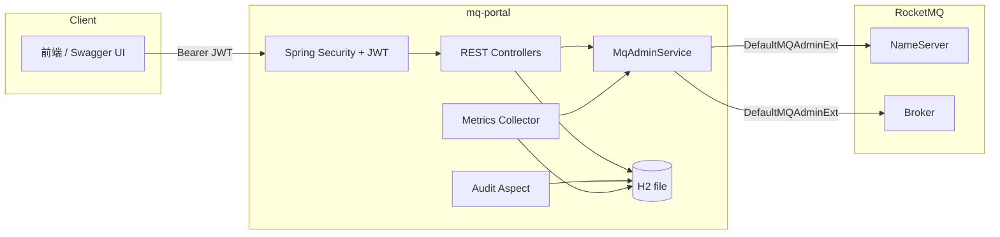

# mq-portal

基于 Apache RocketMQ 的消息队列管理平台后端（MVP）。

提供集群/主题/消费组/消息/监控/审计等管理能力，通过 RocketMQ 官方 `rocketmq-tools` 的
`DefaultMQAdminExt` 完成全部管理操作，本地使用 H2（file 模式）零配置存储元数据。

## 技术栈

- JDK 17 / Spring Boot 3.2.x / Maven
- Apache RocketMQ 5.1.4（`rocketmq-tools`）
- MyBatis-Plus（`mybatis-plus-spring-boot3-starter`）
- H2（file 模式，零配置）
- Spring Security + JWT（jjwt）
- springdoc-openapi（Swagger UI）
- Lombok

## 功能清单

- **认证与权限**：admin / viewer 两种角色，登录签发 JWT；viewer 只读，写操作要求 admin。
- **集群概览**：broker 列表与运行时统计。
- **Topic 管理**：列表（聚合每个 broker 的 maxOffset / 最后写入时间戳）、创建 / 更新 / 删除；
  本地 `topic_meta` 表保存负责人与备注，列表接口将路由数据与本地元数据 join 返回。
- **消费组管理**：列表、创建 / 删除、在线客户端连接、消费进度与堆积量（lag）、重试 / 死信 topic 查看。
- **消息操作**：按 msgKey 查询、按 msgId 查详情与消息体、死信消息直接重发、消费位点按时间戳重置。
- **监控采集**：`@Scheduled` 定时（默认 1 分钟，可配）采集 topic 的 broker offset 总量与消费组堆积量，
  写入 `metrics_snapshot`，提供按 topic / 消费组 + 时间范围查询的时间序列 API。
- **审计日志**：`@AuditLog` 注解 + Spring AOP 拦截写操作，记录操作人、方法、参数摘要、成败与耗时，落 `audit_log` 表。
- **Swagger**：springdoc-openapi，按模块分组 tag。

## 架构图



- `MqAdminService` 是全部 RocketMQ 管理操作的唯一入口，封装 `DefaultMQAdminExt` 的
  创建 / 启动 / 关闭（`@PreDestroy`），并把 RocketMQ 异常统一包装为 `BizException`。
- 对外 API 只暴露扁平化的自有 DTO，不泄漏 RocketMQ 内部类型。

## 快速开始

### 1. 启动 RocketMQ 5.1.4（Docker Compose）

```bash
cd mq-portal
docker compose up -d
```

等待 broker 就绪后，`NameServer` 监听 `localhost:9876`，`Broker` 监听 `localhost:10911`。

### 2. 构建并运行

```bash
export JAVA_HOME="C:/Users/Administrator/.jdks/ms-17.0.16"   # Windows 下显式指定 JDK 17
mvn clean package
java -jar target/mq-portal-0.1.0.jar
```

应用启动后：

- 服务地址：`http://localhost:8080`
- Swagger UI：`http://localhost:8080/swagger-ui.html`
- H2 数据文件：`./data/mqportal`

### 3. 初始账号

| 用户名 | 密码       | 角色  | 权限            |
|--------|------------|-------|-----------------|
| admin  | `admin123` | ADMIN | 全部读写操作    |

初始账号由 `DataInitializer` 在首次启动时写入（密码 BCrypt 加密）。
当前版本未内置 viewer 账号；如需只读账号，可在 `sys_user` 表中新增一条 `role = VIEWER` 的记录，
密码同样使用 BCrypt。

### 4. 登录

```bash
curl -X POST http://localhost:8080/api/auth/login \
  -H "Content-Type: application/json" \
  -d '{"username":"admin","password":"admin123"}'
```

后续请求携带响应中的 `token`：

```bash
curl -H "Authorization: Bearer <token>" http://localhost:8080/api/cluster/overview
```

## API 一览（按模块分组）

| Tag       | 方法 | 路径 | 说明 | 权限 |
|-----------|------|------|------|------|
| auth      | POST | `/api/auth/login` | 登录签发 JWT | 匿名 |
| auth      | GET  | `/api/auth/me` | 当前登录用户 | 登录 |
| cluster   | GET  | `/api/cluster/overview` | 集群与 broker 概览 | 登录 |
| topic     | GET  | `/api/topics` | topic 列表（含本地元数据 join） | 登录 |
| topic     | GET  | `/api/topics/{topic}` | topic 详情 | 登录 |
| topic     | POST | `/api/topics` | 创建 topic | admin |
| topic     | PUT  | `/api/topics/{topic}` | 更新 topic | admin |
| topic     | DELETE | `/api/topics/{topic}` | 删除 topic | admin |
| consumer  | GET  | `/api/consumer/groups` | 消费组列表 | 登录 |
| consumer  | GET  | `/api/consumer/groups/{group}` | 消费组详情 | 登录 |
| consumer  | POST | `/api/consumer/groups` | 创建消费组 | admin |
| consumer  | DELETE | `/api/consumer/groups/{group}` | 删除消费组 | admin |
| consumer  | GET  | `/api/consumer/groups/{group}/connections` | 在线客户端连接 | 登录 |
| consumer  | GET  | `/api/consumer/groups/{group}/consume-stats` | 消费进度与堆积量 | 登录 |
| consumer  | GET  | `/api/consumer/groups/{group}/retry-topics` | 重试 / 死信 topic | 登录 |
| message   | GET  | `/api/message/query` | 按 msgKey 查询 | 登录 |
| message   | GET  | `/api/message/{msgId}` | 消息详情与消息体 | 登录 |
| message   | POST | `/api/message/dead-letter/resend` | 死信消息直接重发 | admin |
| message   | POST | `/api/message/reset-offset` | 消费位点按时间戳重置 | admin |
| metrics   | GET  | `/api/metrics/series` | 监控时间序列查询 | 登录 |
| audit     | GET  | `/api/audit/logs` | 审计日志分页查询 | 登录 |

> 权限说明：viewer 只能访问 GET 接口；所有非 GET 的 `/api/**` 接口要求 admin 角色。

## 配置说明

关键配置位于 `src/main/resources/application.yml`：

| 配置 | 默认值 | 说明 |
|------|--------|------|
| `server.port` | `8080` | 服务端口 |
| `spring.datasource.url` | `jdbc:h2:file:./data/mqportal` | H2 file 模式 |
| `rocketmq.namesrv-addr` | `localhost:9876` | NameServer 地址 |
| `rocketmq.timeout-millis` | `3000` | admin 请求超时 |
| `metrics.collect-interval-ms` | `60000` | 监控采集间隔 |
| `jwt.secret` | 内置演示值 | JWT 签名密钥（生产必须更换） |
| `jwt.expiration-ms` | `86400000` | Token 有效期（1 天） |

## 后续规划

- **前端**：Vue / React 管理控制台，对接现有 REST API。
- **多集群**：支持配置多个 NameServer 集群并切换。
- **审批流**：Topic / 消费组的创建、删除接入审批流程，审批通过后落库并执行。
- **告警**：基于 `metrics_snapshot` 的堆积量阈值告警。
- **消息重投**：死信消息按原始 topic 重建并重投，替代当前的 `consumeMessageDirectly` 方案。
